# PinShot

An open-source screenshot tool for macOS (also runs on Windows and Linux).

Press **⌘⇧4** and you get a selector that looks and behaves like the built-in macOS one: a
crosshair over your live screen. When you release, the screenshot **flies down to the bottom-left
corner** and stays there until you do something with it:
copy it, save it, drag it into another app (it then moves to **Capture History**), annotate it,
pull the text out of it, or pin it on screen. **⌘⇧3** grabs the whole screen, **⌘⇧5** records it, and **⌘⇧6** does scrolling captures.

| Select (macOS-style) | Flies to the corner… | …and waits for you | Annotate | Or pin it |
| --- | --- | --- | --- | --- |
| 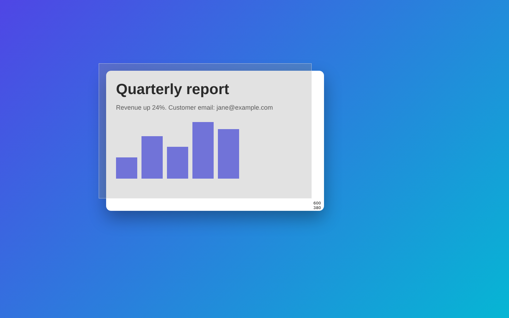 | 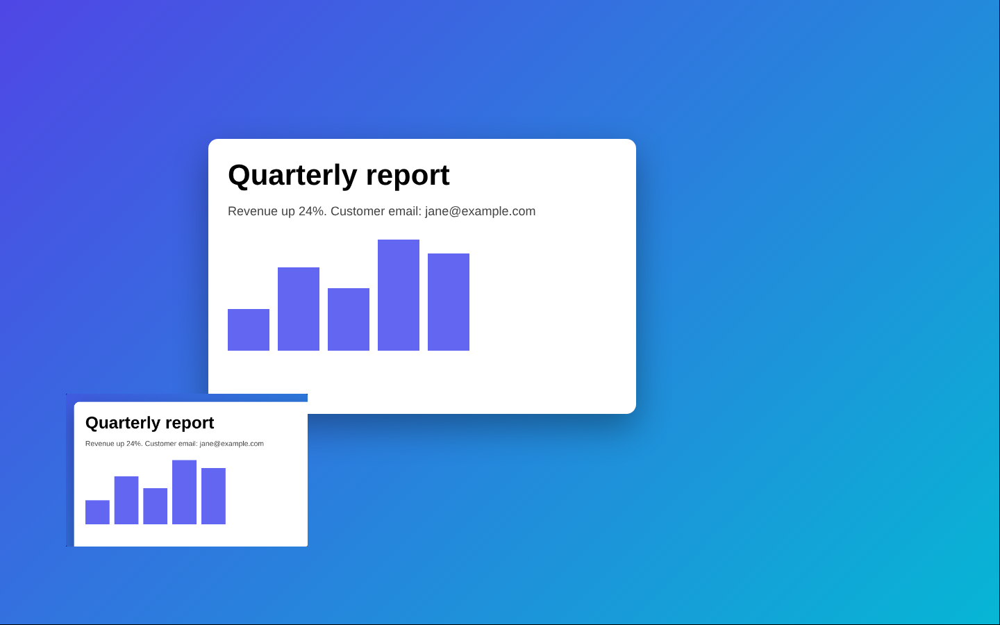 | 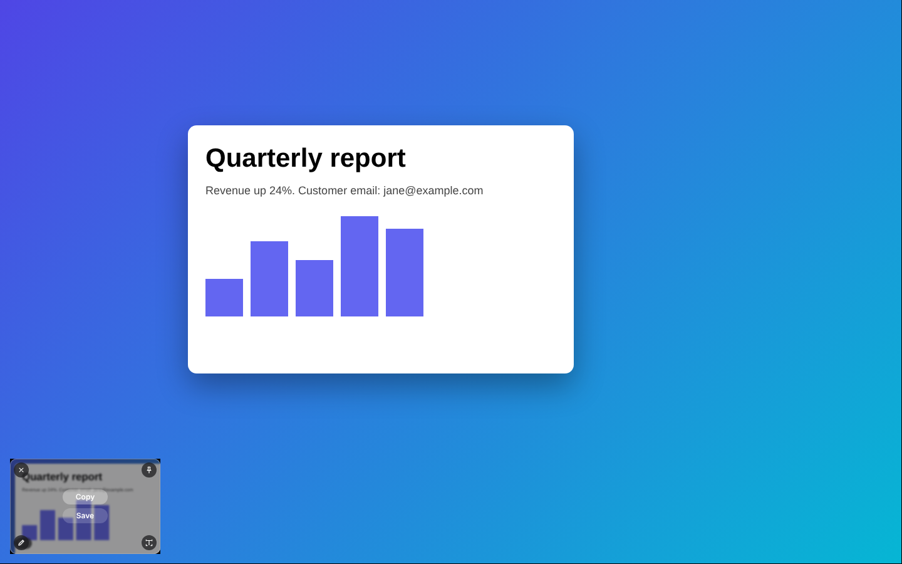 | 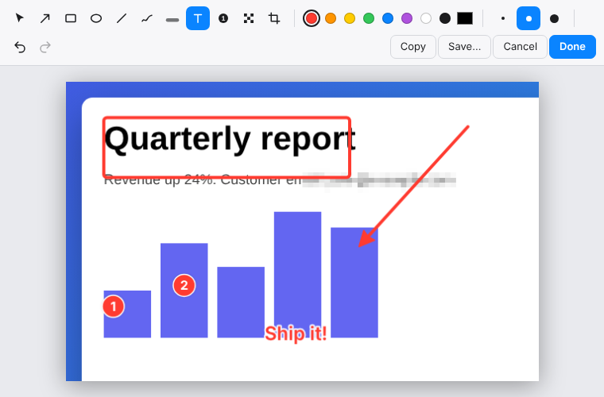 | 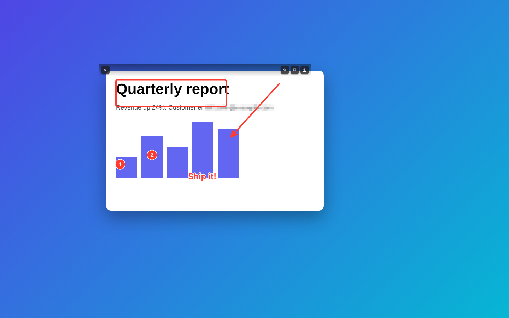 |

| Window capture (Space) | Scrolling capture | Across monitors | Recording | Preferences |
| --- | --- | --- | --- | --- |
| 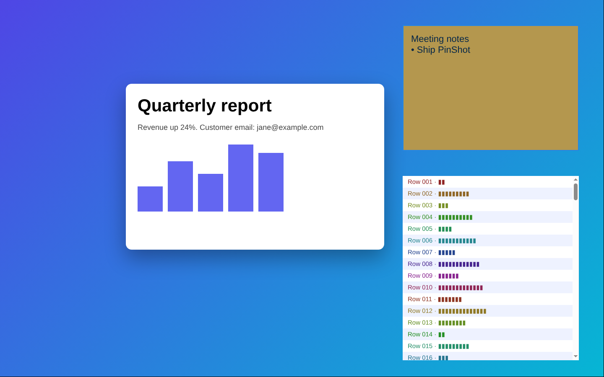 | 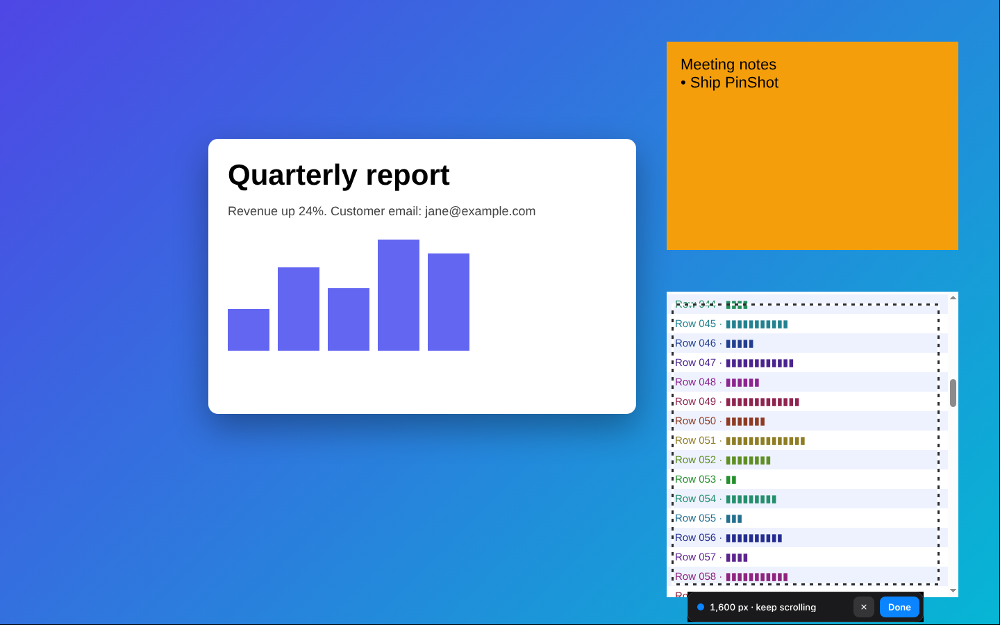 | 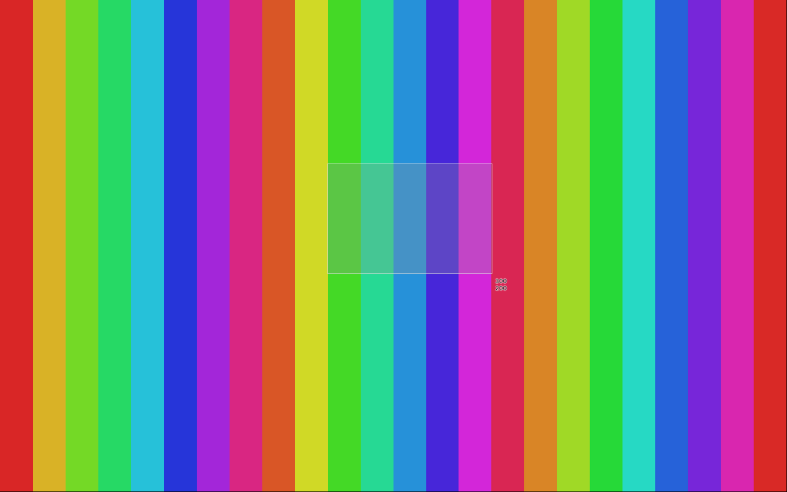 | 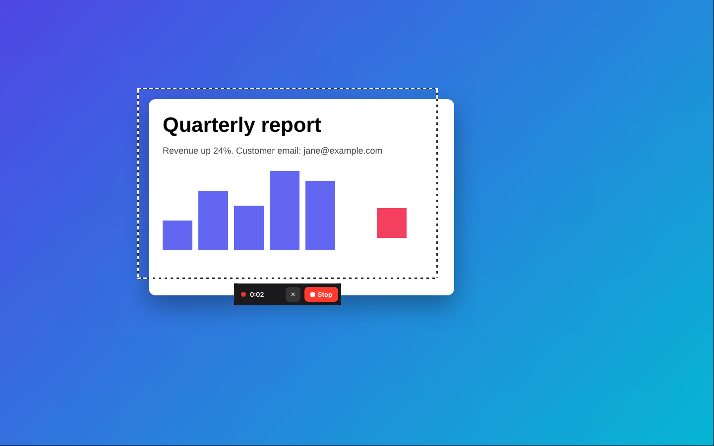 | 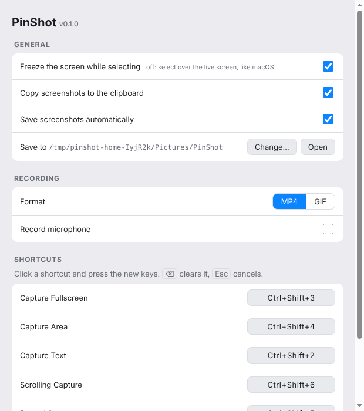 |

| Capture History |
| --- |
| 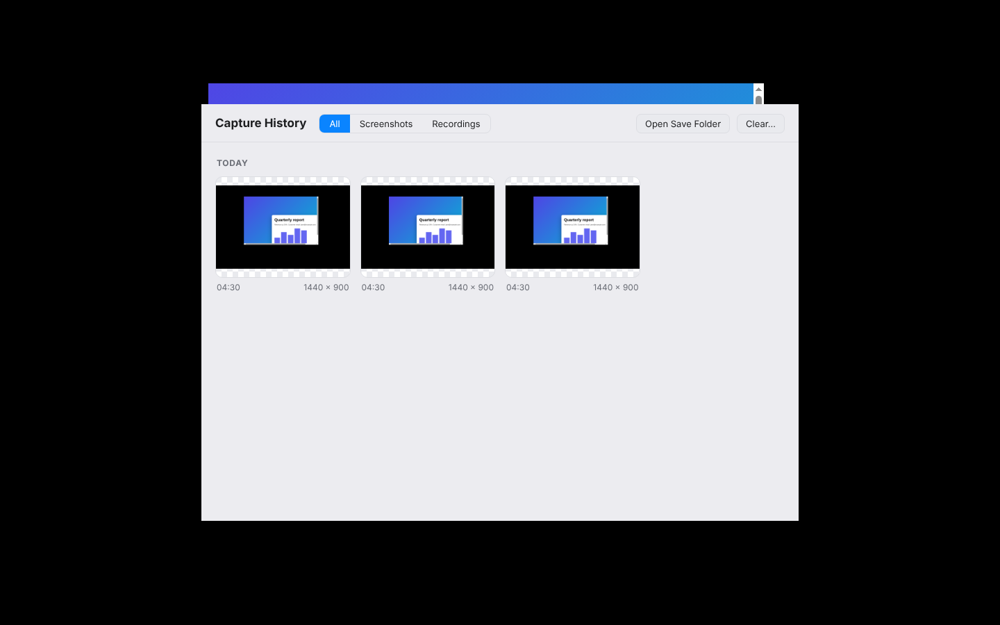 |

## Run it

```bash
git clone https://github.com/Briiick/pinshot.git
cd pinshot
npm install
npm start
```

PinShot lives in the menu bar (there's no dock icon). Open **Preferences…** from its menu. There are
two one-time macOS steps:

1. **Screen Recording permission.** The first capture asks for it. Grant it in *System Settings →
   Privacy & Security → Screen Recording*, then restart PinShot.
2. **Free up ⌘⇧3, ⌘⇧4 and ⌘⇧5.** macOS reserves them for its own screenshot tool, so turn those
   off: *System Settings → Keyboard → Keyboard Shortcuts… →
   Screenshots*, then untick **"Save picture of screen as a file"**, **"Save picture of selected
   area as a file"** and **"Screenshot and recording options"**. PinShot shows these steps on first
   launch, and Preferences links back to them.

To get a real `.app` / `.dmg`, run `npm run dist:mac` (see [Building a Mac app](#building-a-mac-app)).

> [!WARNING]
> **PinShot isn't signed or notarized by Apple.** There's no Developer ID behind it, so a build you
> make yourself is only ad-hoc signed. That means:
>
> - **macOS will warn you the first time you open it** ("PinShot can't be opened because Apple cannot
>   check it for malicious software", or "…is damaged" for a downloaded `.dmg`). Right-click the app →
>   **Open**, or allow it under *System Settings → Privacy & Security*. For a copy you downloaded,
>   `xattr -dr com.apple.quarantine /Applications/PinShot.app` clears the quarantine flag.
> - **Every rebuild looks like a new app to macOS**, so it may ask for Screen Recording (and
>   microphone) permission again after you update. If captures come back blank, remove PinShot from
>   *Privacy & Security → Screen Recording*, add it again and restart it.
> - **Only run builds you made yourself or got from a source you trust.** The app asks for
>   screen-recording access, so read the code first. It's short.

## Features

| Shortcut (change in Preferences) | |
| --- | --- |
| `⌘⇧3` | Capture the whole screen |
| `⌘⇧4` | Capture an area (press `Space` for a window) |
| `⌘⇧2` | **Capture Text**: OCR an area straight to the clipboard |
| `⌘⇧5` | Record the screen. Press it again to stop |
| `⌘⇧6` | Scrolling capture. Press it again to finish |
| `⌘⌥⇧H` | Hide / show all pins |

(On Windows/Linux, read `⌘` as `Ctrl`.)

**Selecting.** Like macOS, the selector sits over your **live** screen (videos keep playing) and
the pixels are grabbed when you let go. Prefer a still image while you select? Turn on **Freeze the
screen while selecting** in Preferences; it's the default on Linux. Drag to pick an area. Selections can span several monitors and are stitched together
at the sharpest display's resolution. The numbers by the crosshair show your position, then the
selection's size. Hold `⇧` for a square, or `⌥` to grow from the centre. Press **`Space` for window
mode**: the window under the cursor turns blue, and a click captures just that window. `Esc` cancels.

**The thumbnail in the corner** stays until you act on it. New captures stack on top. Hover for:
**Copy**, **Save** (PNG or JPEG), **✎ Annotate** (or double-click), **📌 Pin**, **Copy Text**
(OCR) and **✕**. Drag the thumbnail into Finder, Slack, Mail or a browser and, once you drop it,
it leaves the corner for **Capture History**. Release it back on the thumbnail to keep it there.

**Capture History** (in the menu bar menu) keeps every screenshot and recording, grouped by day,
including ones you've dismissed. Hover one to **Copy**, **Pin**, **Annotate**, **Play** or **Show**
it in Finder, drag it into any app, or double-click it to bring it back to the corner. `Delete`
removes it from the history. Screenshots you saved stay in your save folder. Screenshots taken with
auto-save off are kept in the history itself (the 200 most recent), so nothing you take gets lost.

**Capture Text (`⌘⇧2`)** recognises the text in an area and copies it. It works on a screenshot's
thumbnail or pin too. On macOS it uses Apple's Vision framework, the same engine as Live Text.
Elsewhere it uses a bundled, offline Tesseract model.

**Scrolling capture (`⌘⇧6`).** Select the area you'll scroll, then scroll down at a normal pace.
PinShot stitches what it sees into one tall screenshot, live, and ignores sticky headers. Click
**Done** (or press `⌘⇧6`) and it lands in the corner like any screenshot. If you scroll too fast,
the bar asks you to scroll back a little.

**Recording (`⌘⇧5`).** Drag an area, press `Space` for a window, or `Enter` for the full screen. A
small bar shows the timer with **Stop** and **✕ Discard**, and a dashed frame marks the area. Both
stay out of the video. Recordings save as **MP4** (WebM fallback), or as **GIF** if you choose that
format in Preferences, and land in the corner: **Play**, **Save**, **GIF** (make a GIF from an MP4),
show in Finder, or drag out. Optionally include your **microphone** and **system audio** (macOS
13+ and Windows).

**Pins** float above every window and follow you across Spaces. Drag to move, scroll to zoom,
`⌥`+scroll for opacity, `⌘0` for actual size. Double-click to annotate. Right-click for more.

**The editor**

| Tool | Key | | Tool | Key |
| --- | --- | --- | --- | --- |
| Select / move | `V` | | Pen | `P` |
| Arrow | `A` | | Highlighter | `H` |
| Rectangle | `R` | | Text | `T` |
| Ellipse | `O` | | Numbered step | `N` |
| Line | `L` | | Pixelate / redact | `B` |
| Crop | `C` | | Stroke size | `1` `2` `3` |

Annotations stay editable: select one to move it (drag or arrow keys, `⇧` for 10px steps), recolour
it, change its stroke, or `Delete` it. `⌘Z` / `⌘⇧Z` undo and redo. **Done** applies your changes to
the thumbnail, pin and saved file.

**Preferences** cover shortcuts (click one and press new keys; clashes are refused), launch at
login, freezing the screen while selecting, shutter sound, copy/save behaviour and folder, and the
recording format and audio.

## Where captures go

Screenshots are copied to the clipboard and saved as `~/Pictures/PinShot/PinShot <date> at
<time>.png`. Both are optional. Recordings are always saved there, as `PinShot Recording <date> at
<time>.mp4` (or `.gif`). Everything is also listed in Capture History. With auto-save off, its copy
of a screenshot lives in PinShot's app-data folder (`~/Library/Application Support/PinShot/History`
on macOS).

## Building a Mac app

```bash
npm run dist:mac          # dist/PinShot-<version>-arm64.dmg and -x64.dmg
```

If a **Developer ID Application** certificate is in your keychain, electron-builder signs with it.
Otherwise, build ad-hoc signed, which runs on your own Mac (right-click → Open the first time):

```bash
CSC_IDENTITY_AUTO_DISCOVERY=false npm run dist:mac -- -c.mac.identity=- -c.mac.hardenedRuntime=false
```

Turn the hardened runtime off for ad-hoc builds. It's only needed for notarization, and without a
real signing identity it can stop the app from launching. For a quick local install, add `--dir` to
skip the `.dmg` and copy `dist/mac-arm64/PinShot.app` into `/Applications`.

**CI builds signed, notarized releases.** `.github/workflows/ci.yml` runs every test on Linux,
then builds the macOS `.dmg`s and uploads them as artifacts. Add these repository secrets to have
them signed with your Developer ID and notarized by Apple, so they open without warnings on any Mac:
`MAC_CERT_P12_BASE64`, `MAC_CERT_PASSWORD`, `APPLE_ID`, `APPLE_APP_SPECIFIC_PASSWORD`,
`APPLE_TEAM_ID`. Without them the build is ad-hoc signed.

## Development

```bash
npm test          # unit tests: geometry, multi-display compositing, scroll stitching, OCR, settings…
npm run check     # syntax-check every source file
npm run test:ui   # end-to-end on a virtual X display (Linux; needs xvfb, x11-utils, xdotool, ffmpeg)
SHOTS=docs npm run test:ui   # same, and save screenshots of each step
```

The end-to-end tests drive the real app, and a separate "other app" process provides windows to
capture. They cover selection (with a pixel comparison proving the screen doesn't shift), thumbnails
and every thumbnail action, pins, every editor tool, window capture, Capture Text, scrolling capture
(checking the stitched image against the screen), recording area/full screen/discard (decoding
frames to check the video shows the screen), GIF export, Preferences and settings, and Capture History
(including a real mouse drag of a thumbnail out of the corner). Multi-monitor
runs with the screen split into two virtual displays at different densities.

```
src/
  main.js          tray, shortcuts, selector windows, captures, thumbnails, pins, editor,
                   recording, scrolling capture, GIF export, preferences
  windows.js       lists on-screen windows (macOS: CoreGraphics via JXA; Linux: xwininfo)
  ocr.js           text recognition (macOS Vision via JXA; Tesseract elsewhere)
  geometry.js      pure layout maths (rects, pin sizing, thumbnail stack, multi-display compositing)
  settings.js      JSON-backed settings
  history.js       Capture History: the list of past captures and their previews
  preload.js       the IPC bridge exposed to the windows
  renderer/
    overlay.*      the selector (one per display)
    thumb.*        quick-access thumbnail
    pin.*          floating pin
    editor.*       annotation editor
    recorder.*     recording bar; also runs MediaRecorder
    scroll.*       scrolling-capture bar; stitch.js does the stitching
    convert.*      hidden GIF encoder (gifenc)
    prefs.*        Preferences
    history.*      Capture History window
    hud.*          small "Copied 120 characters" toasts
```

## Known limitations

- **Window capture** needs macOS or Linux/X11 (it uses `xwininfo`). On Windows, use area capture.
- **System audio** needs macOS 13+ or Windows. Linux records the microphone only.
- **Scrolling capture** follows downward scrolling of the content inside the area. Sideways
  scrolling isn't supported.
- **Untested on real hardware.** The macOS-specific paths (Vision OCR, window listing, the ⌘⇧ hand-off,
  shutter sound, system audio, detecting the end of a thumbnail drag) were written to Apple's
  documented APIs but tested only on Linux.
  Everything else runs in the test suite.

## License

[MIT](LICENSE)
